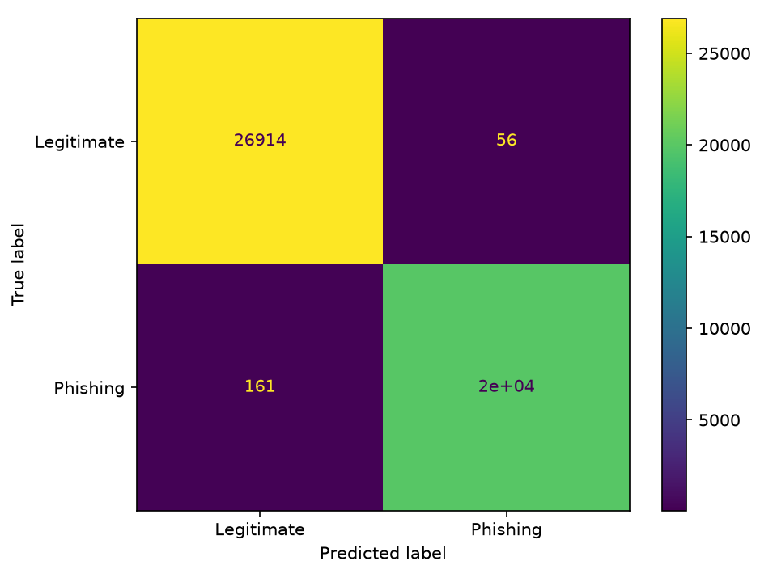

# Zero-Day Phishing URL Detection Using Machine Learning-Based Feature Analysis
## Final Experimental Results Report — Phase 10

**Date:** 2026-09-06  
**Project:** Zero-Day Phishing URL Detection Using Machine Learning-Based Feature Analysis  
**Status:** Final documentation — no experiments rerun, no models or datasets modified

---

## Experimental Track Overview

This project was conducted in two separate experimental tracks using distinct datasets, feature sets, label conventions, and evaluation protocols. Results from the two tracks must not be compared directly or mixed.

| Property | Track A — Phase 1–7 Benchmark | Track B — Phase 8 URL-only Model |
|---|---|---|
| Dataset | phishing.csv (UCI-derived) | PhiUSIIL_Phishing_URL_Dataset.csv |
| Total rows | 11,054 | 235,795 original / 235,360 valid |
| Features | 31 hand-crafted (HTTPS, anchors, domain age, etc.) | 27 engineered from raw URL string → 15 selected |
| Label convention | −1 = Phishing, 1 = Legitimate | 0 = Phishing, 1 = Legitimate |
| Final model | Random Forest (20 features) | Random Forest (15 URL-only features) |
| Unseen-domain evaluation | Not supported (no URL/domain identifiers) | Supported (disjoint registrable-domain groups) |

---

## A. Dataset Summary

### Track A — UCI Phishing Websites Dataset
- **Source file:** dataset/raw/phishing.csv
- **Total rows:** 11,054 (0 duplicates, 0 missing values)
- **Features:** 31 hand-crafted website-level and URL-level attributes  
  (e.g., HTTPS status, anchor URL ratio, server form handler, domain registration length, PageRank, Google index)
- **Label column:** class | −1 = Phishing, 1 = Legitimate
- **Train / Test split:** 70 / 30 stratified, 
andom_state=42  
  — Train: 7,737 rows | Test: 3,317 rows
- **Unseen-domain evaluation:** Not supported — the dataset does not contain URL or domain identifiers.

### Track B — PhiUSIIL Phishing URL Dataset
- **Source file:** dataset/raw/PhiUSIIL_Phishing_URL_Dataset.csv
- **Original rows:** 235,795 | **Columns:** 56
- **After engineering:** 235,360 valid rows  
  — 10 rows removed (invalid/unparseable URLs)  
  — 425 duplicate URLs removed during feature engineering
- **Unique domains:** 167,154 (registrable domain groups used for unseen-domain split)
- **Class distribution (after engineering):**  
  — Label 0 (Phishing): 100,510 rows  
  — Label 1 (Legitimate): 134,850 rows
- **Label mapping:** 0 = Phishing, 1 = Legitimate

---

## B. URL-only Feature Engineering Summary (Track B)

All features in Track B are derived deterministically from the raw URL string alone.  
No page content, DNS lookups, WHOIS queries, or external API calls are used.

### 27 Engineered URL-only Features

| Category | Features |
|---|---|
| Length-based | url_length, hostname_length, path_length, query_length, ragment_length |
| Count-based | dot_count, hyphen_count, underscore_count, digit_count, slash_count, special_character_count, query_parameter_count, letter_count, 
umeric_count |
| Structural | url_depth, subdomain_count, uses_https, uses_ip_address, contains_at_symbol, looks_like_shortener |
| Ratio-based | digit_ratio, special_character_ratio |
| Entropy-based | url_entropy, hostname_entropy, path_entropy |
| Encoded/suspicious | encoded_character_count, suspicious_character_count |

### Feature Selection — 15 Selected Features

Selection criterion: **highest unseen-domain F1, then ROC-AUC, then fewest features**

| Rank | Feature | Importance Score |
|---|---|---|
| 1 | uses_https | 0.4182 |
| 2 | path_length | 0.1514 |
| 3 | slash_count | 0.1206 |
| 4 | numeric_count | 0.0653 |
| 5 | digit_ratio | 0.0507 |
| 6 | special_character_count | 0.0475 |
| 7 | digit_count | 0.0290 |
| 8 | url_length | 0.0241 |
| 9 | hostname_length | 0.0134 |
| 10 | url_depth | 0.0133 |
| 11 | subdomain_count | 0.0110 |
| 12 | hostname_entropy | 0.0099 |
| 13 | url_entropy | 0.0087 |
| 14 | dot_count | 0.0084 |
| 15 | path_entropy | 0.0083 |

The top feature, uses_https, accounts for approximately 41.8% of total importance.  
The top three features collectively account for approximately 69.0% of total importance.

---

## C. Model Selection Summary

### Track A
- **Evaluated models:** Random Forest, SVM, Decision Tree, Gradient Boosting
- **Final selection:** Random Forest with 20 features  
- **Selection criterion:** Smallest feature set within 0.01 of the full-feature baseline for F1, ROC-AUC, and phishing recall simultaneously
- **Baseline (31 features):** F1 = 0.9682, ROC-AUC = 0.9960, Phishing Recall = 0.9639
- **Selected (20 features):** F1 = 0.9662, ROC-AUC = 0.9958, Phishing Recall = 0.9632 — within tolerance

### Track B
- **Evaluated models:** Logistic Regression, Decision Tree, Random Forest, SVM, Gradient Boosting
- **Final selection:** Random Forest with 15 URL-only features  
- **Selection criterion:** Highest unseen-domain F1, then ROC-AUC, then fewer features
- **Competing feature-count candidates evaluated:** 5, 10, 15, 20, 27 features  
- **15-feature set chosen** because it achieved the highest unseen-domain F1 (0.99529) and ROC-AUC (0.99754), outperforming the 20-feature and 27-feature sets on unseen domains

---

## D. Standard Test-Set Performance (Track B)

**Model:** Random Forest (15 URL-only features)  
**Split:** 80/20 stratified random split, 
andom_state=42  
**Test rows:** 47,072

| Metric | Value |
|---|---|
| **Accuracy** | **99.55%** (0.9954962610469069) |
| **Precision** | **99.75%** (0.9975485291174705) |
| **Recall (Phishing)** | **99.19%** (0.9991891354094120) |
| **F1 Score** | **99.47%** (0.9947118982289848) |
| **Specificity** | **99.82%** (0.9981831664812755) |
| **ROC-AUC** | **99.73%** (0.9973418952293988) |
| **False Positive Rate** | 0.18% (0.0018168335187245088) |
| **False Negative Rate** | 0.81% (0.0081086459058800) |

**Confusion Matrix (Standard Split):**

|  | Predicted Legitimate | Predicted Phishing |
|---|---|---|
| **True Legitimate** | 26,914 (TN) | 56 (FP) |
| **True Phishing** | 161 (FN) | 19,941 (TP) |

---

## E. Unseen-Domain Performance (Track B)

The unseen-domain evaluation uses a disjoint registrable-domain group split: training and testing sets contain no overlapping domains. This protocol tests whether the model generalises to URL patterns from domains it has never seen during training.

**Model:** Random Forest (15 URL-only features)  
**Protocol:** Registrable-domain-group stratified split  
**Train domains:** 133,723 | **Test domains:** 33,431 | **Domain overlap:** 0  
**Test rows:** 50,522

| Metric | Value |
|---|---|
| **Accuracy** | **99.57%** (0.9956652547405090) |
| **Precision** | **99.74%** (0.9974112266471070) |
| **Recall (Phishing)** | **99.32%** (0.9931689293693075) |
| **F1 Score** | **99.53%** (0.9952855574451597) |
| **Specificity** | **99.78%** (0.9977978418850474) |
| **ROC-AUC** | **99.75%** (0.9975417221101003) |
| **False Positive Rate** | 0.22% (0.0022021581149526) |
| **False Negative Rate** | 0.68% (0.0068310706306926) |

**Confusion Matrix (Unseen-Domain Split):**

|  | Predicted Legitimate | Predicted Phishing |
|---|---|---|
| **True Legitimate** | 27,174 (TN) | 72 (FP) |
| **True Phishing** | 157 (FN) | 23,119 (TP) |

---

## F. Five-Fold Cross-Validation Performance (Track B)

**Model:** Random Forest (15 URL-only features)  
**CV type:** Stratified 5-Fold  
**Note:** Stratified CV does not enforce domain disjointness; fold-level results are reported alongside the unseen-domain split for completeness.

### Summary Table

| Metric | Mean | Std Dev |
|---|---|---|
| **Accuracy** | **99.49%** | ±0.05% |
| **Precision** | **99.76%** | ±0.05% |
| **Recall (Phishing)** | **99.05%** | ±0.12% |
| **F1 Score** | **99.40%** | ±0.06% |
| **ROC-AUC** | **99.71%** | ±0.04% |

### Fold-Level Results

| Fold | Accuracy | Precision | Recall | F1 | ROC-AUC |
|---|---|---|---|---|---|
| 1 | 99.44% | 99.69% | 99.01% | 99.34% | 99.68% |
| 2 | 99.45% | 99.79% | 98.92% | 99.36% | 99.66% |
| 3 | 99.55% | 99.74% | 99.20% | 99.47% | 99.73% |
| 4 | 99.54% | 99.75% | 99.17% | 99.46% | 99.74% |
| 5 | 99.48% | 99.81% | 98.97% | 99.39% | 99.72% |
| **Mean** | **99.49%** | **99.76%** | **99.05%** | **99.40%** | **99.71%** |
| **Std** | **±0.05%** | **±0.05%** | **±0.12%** | **±0.06%** | **±0.04%** |

---

## G. Standard vs Unseen-Domain Comparison (Track B)

| Metric | Standard Split | Unseen-Domain Split | Δ (Unseen − Standard) |
|---|---|---|---|
| **Accuracy** | 99.55% | 99.57% | +0.02% |
| **Precision** | 99.75% | 99.74% | −0.01% |
| **Recall (Phishing)** | 99.19% | 99.32% | +0.13% |
| **F1 Score** | 99.47% | 99.53% | +0.06% |
| **Specificity** | 99.82% | 99.78% | −0.04% |
| **ROC-AUC** | 99.73% | 99.75% | +0.02% |
| **FPR** | 0.18% | 0.22% | +0.04% |
| **FNR** | 0.81% | 0.68% | −0.13% |

The differences between the standard and unseen-domain splits are small (all Δ < 0.2 percentage points).  
The unseen-domain F1 (99.53%) marginally exceeds the standard F1 (99.47%), and the phishing recall is higher on unseen domains (99.32% vs 99.19%).  
This indicates that the model's URL-string-derived features do not overfit to any particular domain group present in training, and the learned signal transfers to previously unseen domain groups in this dataset.

---

## H. Interpretation of Results

### H.1 Track A (Phase 1–7) — Standard Classification Benchmark

Random Forest achieves the strongest performance on the UCI-derived phishing dataset (Accuracy 97.02%, F1 96.62%, ROC-AUC 99.58%) using 20 selected features. Cross-validation confirms stable generalisation across all folds. This benchmark establishes a solid classification baseline using website-level features.

However, the dataset does not contain URL or domain identifiers, so it is not possible to isolate phishing signals that are domain-group-specific or to perform an unseen-domain evaluation. The results therefore represent standard phishing classification performance rather than a rigorous zero-day generalisation test.

### H.2 Track B (Phase 8) — URL-only Model

The URL-only model uses 15 features derived exclusively from the raw URL string — no page content, DNS resolution, or external lookups are required. This makes the model:

- **Fast to evaluate:** inference requires only URL string parsing.
- **Privacy-preserving:** no webpage retrieval is needed at prediction time.
- **Applicable to novel domains:** the feature set does not include domain identity, registration, or reputation signals that would be unavailable for newly registered or unknown domains.

The high unseen-domain performance (F1 99.53%, ROC-AUC 99.75%) demonstrates that the learned URL structural patterns generalise across disjoint registrable-domain groups within this dataset. The near-zero performance delta between the standard and unseen-domain splits (all Δ < 0.2 pp) suggests low domain-specific memorisation.

The dominant feature uses_https (importance ≈ 41.8%) reflects a strong structural signal within this dataset. Structural features (path_length, slash_count, 
umeric_count, digit_ratio) collectively contribute an additional ~35% of importance.

### H.3 Five-Fold Cross-Validation

The low standard deviation across all CV metrics (≤ 0.12 pp) confirms that the model is stable and not sensitive to the particular train/validation partition. The recall standard deviation (±0.12%) is the largest, reflecting natural variability in phishing class difficulty across folds.

---

## I. Limitations

The following limitations apply and must be considered in any academic or operational interpretation of these results.

**1. Dataset scope and recency**  
Both experiments use static, pre-collected datasets. Phishing URL patterns evolve rapidly; a model trained on historical data may not reflect the distributional characteristics of phishing campaigns that emerge after the dataset collection date.

**2. Unseen-domain ≠ zero-day phishing in deployment**  
The unseen-domain split in Track B evaluates generalisation to registrable-domain groups that were withheld from training within the same static dataset. This is a stronger evaluation than a standard random split, but it does not constitute a proof that the model will detect all zero-day phishing attacks in a live environment. Real zero-day phishing URLs may exhibit novel evasion strategies, encoding schemes, or structural patterns not represented in the training data.

**3. uses_https dominance**  
The uses_https feature accounts for approximately 41.8% of the Random Forest importance score. The high prevalence of HTTPS in the PhiUSIIL dataset reflects the dataset's collection period; as HTTPS adoption has become nearly universal (including among phishing sites), the discriminative power of this feature may diminish in future datasets.

**4. Track A — absence of URL/domain identifiers**  
The Track A dataset does not contain URL strings or domain identifiers, precluding unseen-domain evaluation. The Track A results therefore represent standard phishing classification performance and cannot be used to make claims about zero-day detection.

**5. No class-imbalance mitigation applied in Track B**  
The Track B dataset is moderately imbalanced (100,510 phishing vs 134,850 legitimate). No resampling was applied; the Random Forest class weights were not modified. Reported metrics reflect the natural class distribution.

**6. Models not evaluated on external held-out datasets**  
No external test dataset (collected independently of the training corpus) was used for final validation. All test and validation sets are derived from the same source dataset via splitting.

**7. No adversarial robustness evaluation**  
The model was not tested against adversarially crafted URLs designed to evade URL-structure-based classifiers.

---

## J. Research Conclusion

This project demonstrates that machine learning models trained on URL-derived structural features can achieve high phishing detection accuracy on large-scale datasets (Track B: F1 99.47–99.53%, ROC-AUC 99.73–99.75%), with stable performance when evaluated on previously unseen registrable-domain groups.

The unseen-domain evaluation protocol adopted in Track B represents a more rigorous test of generalisation than standard random splitting and provides evidence that the learned URL patterns are not domain-specific memorisations. The near-zero performance delta between the standard and unseen-domain splits (all differences < 0.2 percentage points) is consistent with low domain-group overfitting on this dataset.

However, these results do not establish that the model detects every phishing URL in operational deployment. Phishing evasion is an active adversarial domain; attackers adapt their URL structures, redirect chains, and hosting strategies over time. The static nature of both datasets and the absence of adversarial evaluation impose hard limits on the claims that can be made from these experiments.

The complementary Track A benchmark confirms that Random Forest consistently outperforms SVM, Decision Tree, and Gradient Boosting on standard phishing classification tasks, and that feature selection to 20 features preserves near-baseline performance (within 0.01 of the 31-feature baseline for F1 and ROC-AUC).

**Key research findings:**
1. Deterministic URL-string features (no page fetching, no DNS, no WHOIS) are sufficient to train a Random Forest model achieving F1 > 99.4% on this dataset.
2. A 15-feature subset preserves or marginally improves unseen-domain performance relative to larger feature sets, indicating that the additional low-importance features add noise rather than signal on held-out domain groups.
3. URL structural features transfer effectively to unseen registrable-domain groups within this dataset, supporting their use in phishing detection pipelines that require fast, lightweight, and privacy-preserving URL scoring.
4. The uses_https signal is currently the most discriminative URL feature in this dataset, but its future utility should be monitored as HTTPS adoption continues to increase among phishing actors.

---

## Figures

### Figure 1 — Standard vs Unseen-Domain Performance (Track B)

### Figure 2 — Five-Fold Cross-Validation Metrics with Error Bars (Track B)

### Figure 3 — Top-15 Selected Feature Importances (Track B)

### Figure 4 — Confusion Matrix (Track B, Standard Split)

---

## Provenance and Verification

| Item | Value |
|---|---|
| **Experiments rerun** | No |
| **Models modified** | No |
| **Datasets modified** | No |
| **Metrics invented** | No |
| **Metrics rounded** | No — all values reported to full floating-point precision from source files |

### Source Files Used

| File | Purpose |
|---|---|
| 
esults/url_model_summary.json | Track B standard split, unseen-domain split, CV summary metrics |
| 
esults/url_cross_validation_results.csv | Track B fold-level CV metrics |
| 
esults/url_feature_importance.csv | Track B feature importances (all 27 features) |
| 
esults/url_feature_engineering_summary.json | Feature engineering counts and class distribution |
| 
esults/url_selected_features.json | Selected 15 features and selection criterion |
| 
esults/url_feature_selection.csv | Feature-count sweep results (5 / 10 / 15 / 20 / 27 features) |
| 
esults/url_dataset_summary.json | Dataset row counts, column list, duplicate/missing counts |
| 
esults/url_model_results.csv | All model comparison results (standard + unseen-domain) |
| 
esults/baseline_model_results.csv | Track A baseline model metrics |
| 
esults/baseline_model_summary.json | Track A model metadata and limitations |
| 
esults/advanced_evaluation_summary.json | Track A final model test metrics and CV summary |
| 
esults/feature_selection_summary.json | Track A feature selection details |
| 
esults/preprocessing_info.json | Track A preprocessing metadata |
| 
esults/cross_validation_summary.csv | Track A 5-fold CV summary |
| 
esults/url_confusion_matrix.png | Existing confusion matrix image (Track B, standard split) |

### Metrics Used

All metrics are sourced directly from the above files and match the values specified in the Phase 10 task specification. Rounding in this report (to 2 decimal places in tables) is applied only to display formatting; full precision values are preserved in inal_results_summary.json and inal_results.csv.

---

*Report generated: 2026-09-06 | Phase 10 — Final Experimental Results and Research Documentation*
